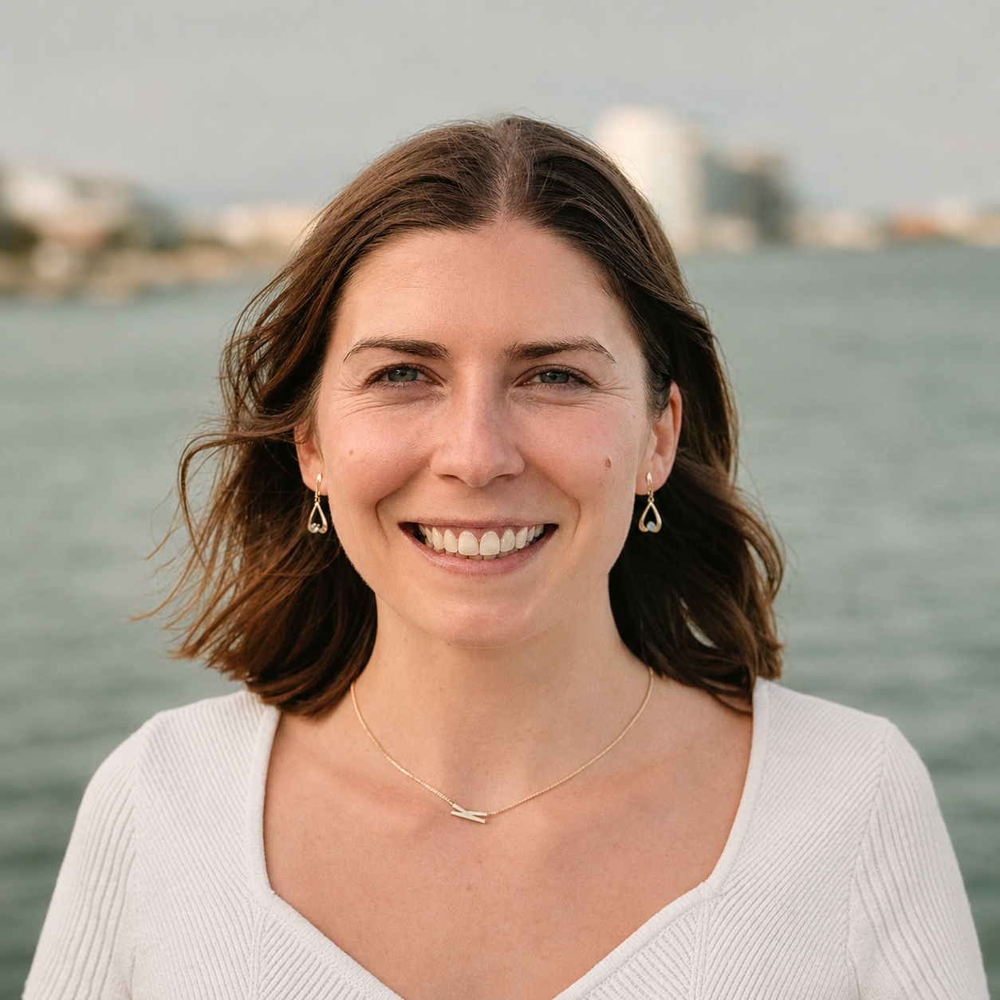
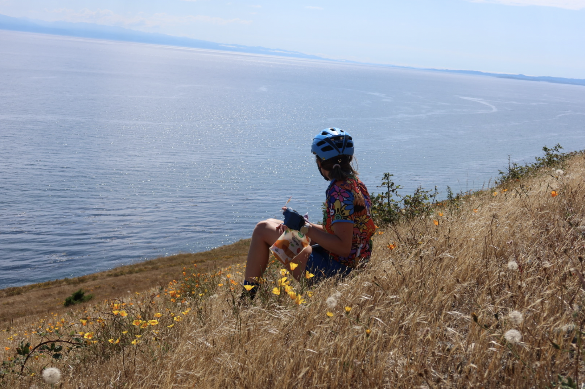

::: {.about-container}

::: {.about-hero}

::: {.about-intro}

<!-- [ BIOSTATISTICIAN · RESEARCHER · ILLUSTRATOR ]{.eyebrow} -->

## About me

I'm a PhD student in Biostatistics at the University of Washington,
advised by [Dr. Marco Carone](https://www.biostat.washington.edu/),
and a graduate student researcher in [Dr. Helen Chu](https://www.chulab.org/)'s infectious
disease research group.

I'm broadly interested in developing statistical methodology
motivated by challenges in biomedical research. My current research
interests include causal inference, complex and time-varying
exposures, time-to-event outcomes, and applications in infectious
disease and vaccine research.

[Curriculum vitae](static/hoffman_cv_nov26.pdf){.btn .btn-outline-primary}
[Google Scholar](https://scholar.google.com/citations?user=73RvTUoAAAAJ&hl=en){.btn .btn-outline-primary}

:::

::: {.about-photo}

{fig-alt="Portrait of Katherine Hoffman"}

:::

:::

## My path to biostatistics

I grew up in a small town in Michigan and studied
biochemistry at the University of Detroit Mercy, where I also
played Division I softball. During and after college, I took care of patients as a nurse assistant at a hospital in Michigan in a health clinic in rural Nicaragua.
I went on to pursue a Master's of Science
in Biostatistics at the University of Michigan.

After earning my MS and before beginning my PhD, I spent five years working as a
collaborative biostatistician in New York City, first at Weill
Cornell Medicine and then at Columbia University. My experiences
working alongside clinical researchers motivated my interest in
developing statistical methods for answering complex scientific
questions.

::: {.career-timeline}

::: {.career-entry}

[2023–Present]{.career-date}

**University of Washington**

PhD in Biostatistics

:::

::: {.career-entry}

[2022–2023]{.career-date}

**Columbia University**

Senior Data Analyst, Epidemiology

:::

::: {.career-entry}

[2018–2022]{.career-date}

**Weill Cornell Medicine**

Collaborative Biostatistician

:::

::: {.career-entry}

[2016–2018]{.career-date}

**University of Michigan**

MS in Biostatistics

:::

::: {.career-entry}

[2011–2015]{.career-date}

**University of Detroit Mercy**

BS in Biochemistry

:::

:::

## Writings and illustrations

I started KHstats to share my first blog post, [*A Day in the Life of a Biostatistician*](blog/ditl/), which has since reached several thousand readers. I discovered biostatistics almost by chance, and I wanted to help others explore and better understand biostatistics as a career.

Since that first post, I've expanded KHstats to include statistical tutorials, R programming tips, educational illustrations, and occasional reflections on working as a biostatistician. I enjoy teaching and finding intuitive ways to explain complex statistical concepts, both to deepen my own understanding and to make these topics more accessible to others.

[→ Explore my illustrations](art/illustrations_viz.qmd)

[→ Browse my writing](blog.qmd)

<!-- ::::: {.outside-section} -->

<!-- :::: {.outside-text} -->

<!-- ## Outside of statistics -->

<!-- When I'm not doing statistics, I enjoy spending time -->
<!-- away from screens, either on a creative project or -->
<!-- in the outdoors. -->

<!-- :::: -->

<!-- :::: {.outside-photo} -->

<!-- {width=240px fig-alt="Cycling in the San Juan Islands" fig-align="default"} -->

<!-- [Cycling in the San Juan Islands]{.photo-caption} -->

<!-- :::: -->

<!-- ::::: -->

## Get in touch

I'm always happy to connect with others interested in
biostatistics, causal inference, collaborative research,
and statistical education.

[Email](mailto:kathoffman.stats@gmail.com) ·
[GitHub](https://github.com/kathoffman) ·
[LinkedIn](https://www.linkedin.com/in/katherinelhoffman/) ·
[Bluesky](https://bsky.app/profile/kathoffman.bsky.social) ·
[X (inactive)](https://x.com/kat_hoffman_)

:::
