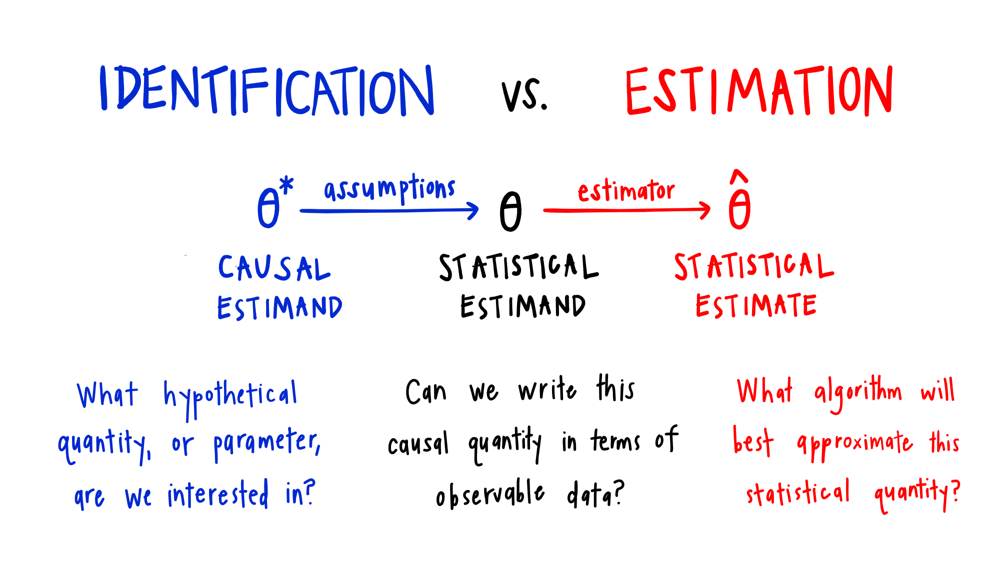
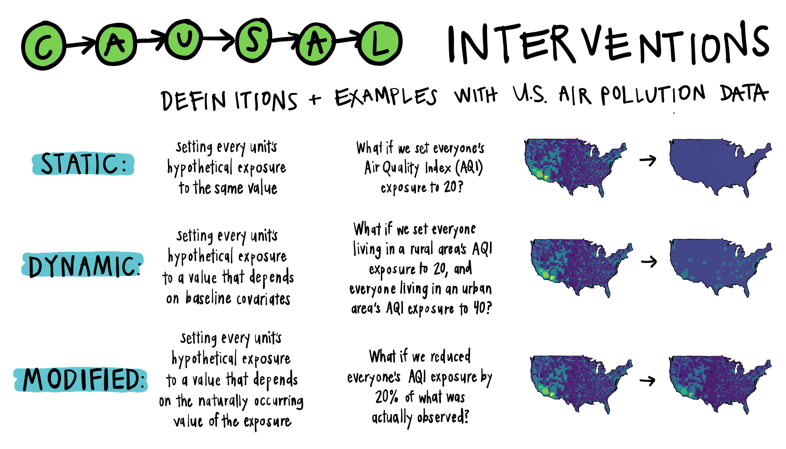
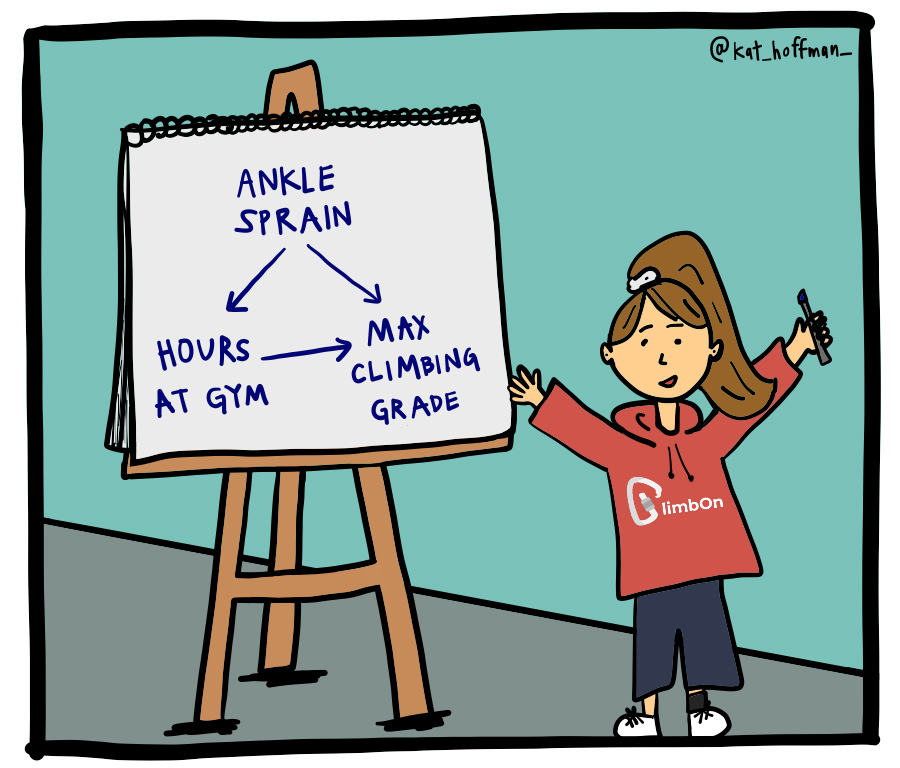
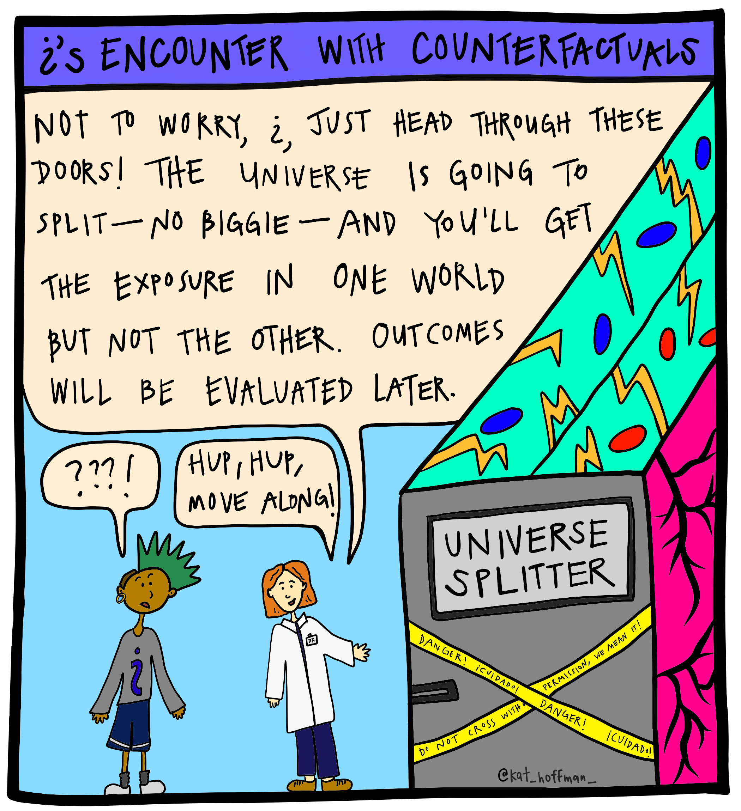
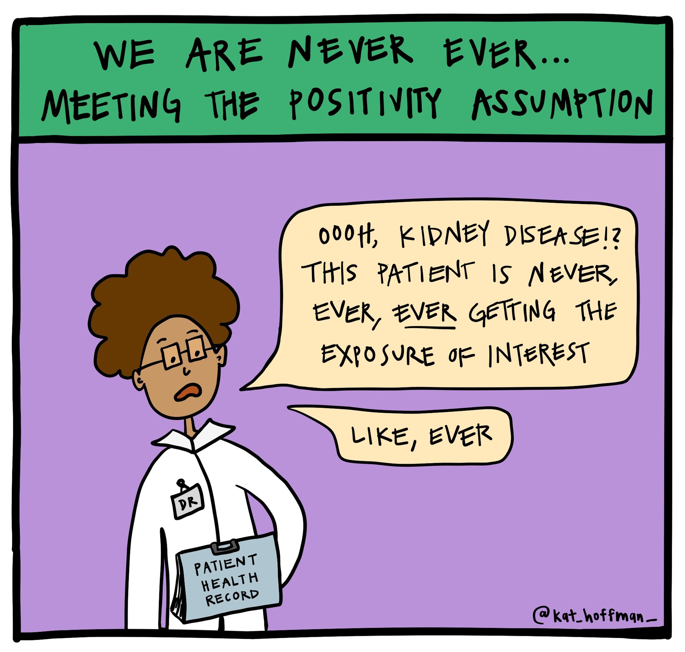
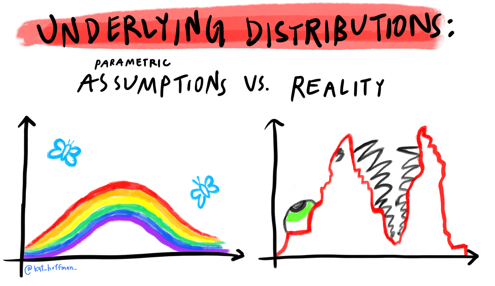

::: {.illustration-container}

::: {.gallery-intro}

<!-- A collection of drawings and comics exploring statistical -->
<!-- intuition, causal inference, and the sometimes humorous -->
<!-- experience of being a statistician. -->

[High-resolution downloads on GitHub](https://github.com/kathoffman/causal-inference-visual-guides){.btn .btn-outline-primary}

:::

## Statistical concepts

::: {.illustration-grid}

::: {.illustration-card}

{.gallery-image fig-alt="Identification versus estimation in causal inference"}

### Identification vs. estimation

Distinguishing causal identification from statistical estimation.

[View full image](../img/ident-vs-est.png){.gallery-link}

:::

::: {.illustration-card}

{.gallery-image fig-alt="Static, dynamic, and modified treatment policies"}

### Static, dynamic, and modified treatment policies

Visualizing different types of interventions in causal inference.

[View full image](../img/lmtp/mtp_summary.jpg){.gallery-link}

:::

:::

## Statistical comics

::: {.illustration-grid .comic-grid}

::: {.illustration-card}

{.gallery-image fig-alt="Climbing comic"}

### Climbing

[View full image](../img/climbing_comic.JPG){.gallery-link}

:::

::: {.illustration-card}

{.gallery-image fig-alt="Universe comic"}

### The universe

[View full image](../img/universe_comic.jpeg){.gallery-link}

:::

::: {.illustration-card}

{.gallery-image fig-alt="Positivity comic"}

### Positivity

[View full image](../img/positivity_comic.jpeg){.gallery-link}

:::

::: {.illustration-card}

{.gallery-image fig-alt="Underlying distributions comic"}

### Underlying distributions

[View full image](../img/underlying_distributions.jpeg){.gallery-link}

:::

:::

::: {.illustration-license}

**Using these illustrations**

All illustrations are available under a CC BY license.
Please provide attribution to Kat Hoffman when sharing
or adapting these drawings.

:::

:::
