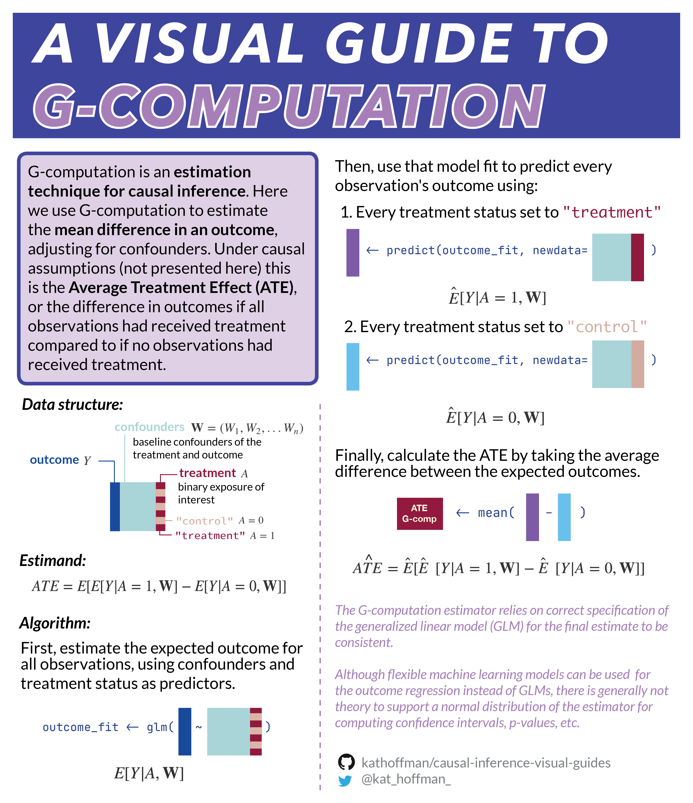
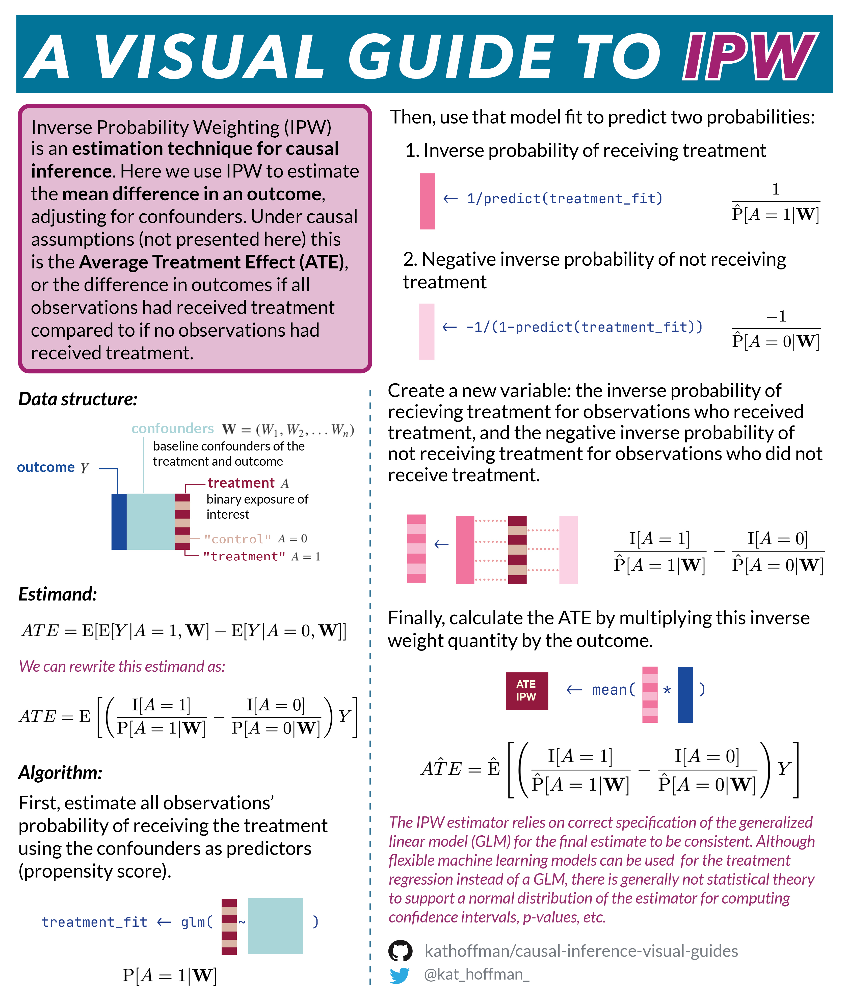

::: {.illustration-container}

::: {.gallery-intro}

An illustrated introduction to causal inference and statistical
estimation. These guides are designed to build intuition for
statistical methods that can otherwise feel mathematically
intimidating.

[High-resolution downloads on GitHub](https://github.com/kathoffman/causal-inference-visual-guides){.btn .btn-outline-primary}

:::

## Estimation methods

The estimation guides consider a mean difference in outcomes
under a binary exposure. Under causal assumptions, this quantity is known as the Average Treatment Effect (ATE).

::: {.illustration-grid}

::: {.illustration-card}

{.gallery-image fig-alt="Illustrated guide to g-computation"}

### G-computation

Estimating causal effects through outcome regression and
standardization.

[View full image](../img/gcomp.jpeg){.gallery-link}

:::

::: {.illustration-card}

{.gallery-image fig-alt="Illustrated guide to inverse probability weighting"}

### Inverse probability weighting

Reweighting observations using estimated treatment probabilities.

[View full image](../img/ipw.jpeg){.gallery-link}

:::

::: {.illustration-card}

{.gallery-image fig-alt="Illustrated guide to targeted maximum likelihood estimation"}

### Targeted maximum likelihood estimation

A doubly robust estimation approach that combines initial
outcome and treatment models through a targeting step.

[View full image](../img/tmle.jpeg){.gallery-link}

:::

:::

## Statistical learning

::: {.illustration-grid}

::: {.illustration-card}

{.gallery-image fig-alt="Illustrated guide to Super Learning"}

### Super Learning

An ensemble learning method that combines predictions from
a library of candidate learners.

[View full image](../img/superlearning.jpeg){.gallery-link}

:::

:::

::: {.illustration-license}

**Using these illustrations**

These guides are freely available under a CC BY license.
You are welcome to share and adapt them with attribution
to Kat Hoffman.

PDFs and high-resolution images are available in the
[GitHub repository](https://github.com/kathoffman/causal-inference-visual-guides).

:::

:::
