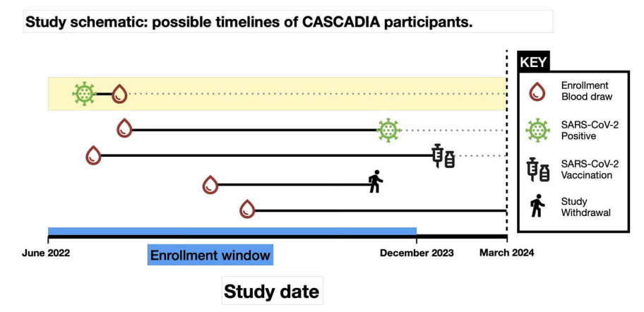
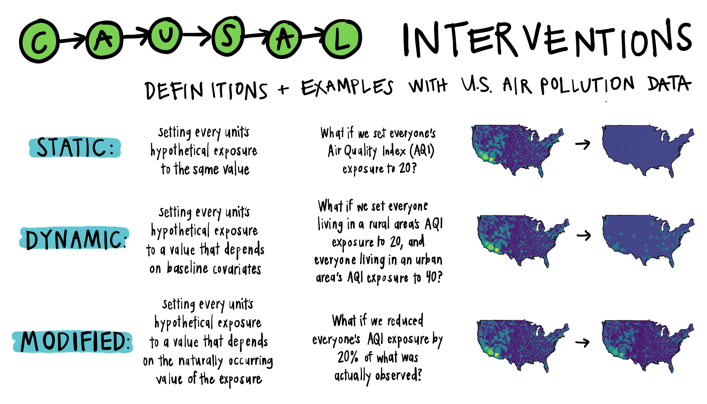

::: {.home-container}

::: {.home-hero}

::: {.hero-intro}

[ BIOSTATISTICS · CAUSAL INFERENCE · INFECTIOUS DISEASE]{.eyebrow}

# Kat Hoffman

[Statistics, biomedical research, and education.]{.hero-tagline}

I'm a biostatistician and PhD student at the University
of Washington, developing statistical methodology
motivated by challenges in infectious disease and
vaccine research.

I'm particularly interested in assumption-lean causal inference in the presence of time-varying and/or continuous exposures and time-to-event and/or composite outcomes.

[Curriculum vitae](static/hoffman_cv_nov26.pdf){.btn .btn-outline-primary}

:::

::: {.hero-photo}

{fig-alt="Rock climbing outdoors"}

:::

:::

## Explore my work

::: {.home-cards}

::: {.home-card}

[{.card-image fig-alt="Figure from Hoffman et al. (2026)"}](publications.qmd)

::: {.card-content}

### [Research](pubs/pubs_methods.qmd)

Statistical methodology and applications in biomedical research.

[Explore research →](publications.qmd){.card-link}

:::
:::

::: {.home-card}

[{.card-image fig-alt="Illustrated guide to Super Learning"}](art/illustrations_viz.qmd)

::: {.card-content}

### [Illustrations](art/illustrations_viz.qmd)

Visual guides, educational drawings, and comics that make complex statistical concepts more intuitive.

[Browse illustrations →](art/illustrations_viz.qmd){.card-link}

:::
:::

::: {.home-card}

[{.card-image fig-alt="MTP summary"}](blog.qmd)

::: {.card-content}

### [Writing](blog.qmd)

Tutorials and reflections on statistics, programming, data visualization, and academic life.

[Read my blog →](blog.qmd){.card-link}

:::
:::

:::
